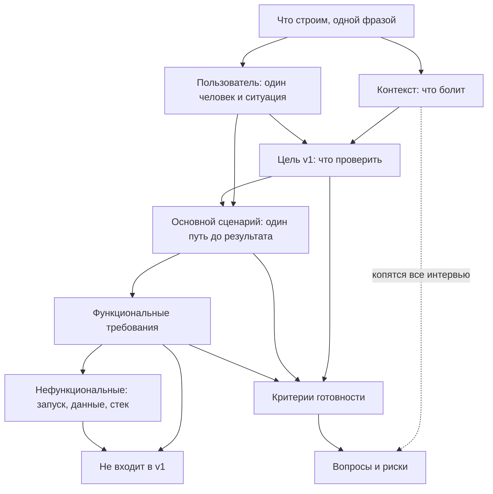

# prd-grill

Скилл для Claude и других агентов, который проводит интервью по твоему проекту и собирает мини-PRD из 9 блоков до того, как агент начнет писать код. Сделан в [AI Lab](https://www.ai-lab-agents.com) для тех, кто только начинает работать с агентскими системами и пишет свой первый PRD. Видео и конспект по теме: [PRD для агентов](https://prd-for-agents.vercel.app).

Логика интервью основана на [grill-me](https://github.com/mattpocock/skills) Мэтта Покока: вопросы идут раундами по дереву решений, у каждого вопроса есть варианты, рекомендация и объяснение, на что влияет выбор. Шаблон PRD, пример и промпты агенту взяты из учебного лендинга.


Ролик собран кастомным скиллом лаборатории для видео из проекта, построенным поверх [HyperFrames](https://hyperframes.heygen.com/). Полное разрешение: [mp4](docs/video/prd-grill-explainer.mp4).

## Ради чего

Человек приходит к агенту с идеей в одну фразу: «сервис для планирования задач с AI». Агент начинает писать код, и все, чего в фразе не было, он додумывает сам: кто пользователь, нужна ли регистрация, где лежат данные, что значит «готово». Через час у него есть проект, который он не понимает, не может проверить и не знает, где остановить.

PRD на одну страницу решает это до первой строки кода. Автор проекта сам отвечает на девять вопросов, и каждый ответ можно проверить руками, без знания кода. Документ становится контрактом с самим собой: вот что строим, вот для кого, вот где останавливаемся, вот как поймем, что получилось.

Скилл нужен, чтобы пройти этот путь в первый раз с проводником: с объяснением, зачем каждый вопрос, с вариантами ответа и с рекомендацией, которая всегда тянет к самой маленькой рабочей версии. Задача на длинной дистанции: человек задает эти девять вопросов себе сам, без скилла.

## Что здесь сделано

- **Скилл `prd-grill`**: инструкция для агента, как вести интервью и собирать PRD. Работает в Claude Code, Claude.ai, Codex, Cursor и других агентах, которые читают `SKILL.md`.
- **Дерево решений из 9 блоков** с зависимостями: что от чего зависит, в каком порядке спрашивать, что считать готовым ответом.
- **Карта вопросов** (`references/question-map.md`): для каждого блока вопросы, объяснение «На что влияет», типовые варианты ответа, красные флаги, примеры хороших и плохих формулировок.
- **Шаблон PRD** (`references/prd-template.md`) и **заполненный пример** (`references/example-prd.md`): те же 9 блоков, что на лендинге.
- **Промпты следующего шага** (`references/next-steps.md`): три промпта агенту после PRD: понимание, реализация, проверка.
- **Разбор одного интервью** ([docs/walkthrough.md](docs/walkthrough.md)): реальный прогон от идеи до PRD, шесть раундов с ответами автора и комментариями, что произошло в каждом.
- **Установка тремя способами**: маркетплейс плагинов Claude Code, `npx skills`, файл `.skill` для Claude.ai.

## Как это работает

Проект раскладывается в дерево решений: каждое решение открывает те, что от него зависят.



**Фронтир и раунды.** Фронтир — вопросы, которые уже можно задать, потому что все, от чего они зависят, решено. Скилл берет из фронтира до трех самых корневых вопросов и задает их одним раундом. Ответ на них пересчитывает фронтир, открывается следующий раунд. В разобранном прогоне интервью заняло шесть раундов.

**Один вопрос раунда выглядит так:**

> **В2 — Где живет бот и когда пишет.**
> На что влияет: сценарий и ограничения. «Приходит само» означает расписание и машину, которая не спит в это время; «пишу боту сам» проще в сборке, но боль с забыванием не лечит.
> а) Telegram, сообщение приходит само в фиксированное время. Рекомендую.
> б) Telegram, автор сам пишет боту.
> в) Другой канал: почта, уведомление.

Три части: вопрос простыми словами, строка «На что влияет» (какой блок PRD заполняет, что агент сделает по-разному, что случится при размытом ответе) и варианты с последствием в одну фразу. Рекомендованный вариант всегда тянет к самой маленькой рабочей v1: один пользователь, один сценарий, данные локально, без регистрации, без оплат. Автор проекта выбирает вариант, отвечает «ок» на рекомендацию или пишет своими словами; свой ответ важнее вариантов.

**Эхо после раунда.** Перед следующим раундом скилл показывает, что изменилось: что записано точными словами, что ушло в «Не входит в v1» или в риски, какие вопросы закрылись или открылись. Автор проекта видит, как его решения двигают проект.

**Что скилл ловит в ответах.** Непроверяемые слова («удобно», «быстро», «умный»), «для всех», несколько сценариев сразу, новые функции посреди интервью, «не знаю». На каждое он объясняет в одну-две строки, почему это проблема именно для агента, и предлагает две-три конкретные переформулировки. «Не знаю» — честный ответ, он уходит в риски с безопасным значением по умолчанию.

**Факты и решения.** Факты (что уже есть в папке проекта, какой стек, что в README) скилл ищет сам. Решения (что входит в v1, кто пользователь) всегда принимает автор проекта.

**Границы PRD.** Три правила держат документ маленьким. Развилка, которую PRD не решает, уходит в «Вопросы и риски» одной строкой и не становится требованием. Инструкции агенту о порядке работы («сначала план, потом код») в PRD не попадают, они живут в промптах. Пробел, найденный при проверке документа, добавляется вопросом в риски, список требований от него не растет.

**Финал.** Когда фронтир пуст, скилл показывает резюме в семь строк, ждет подтверждения и только потом собирает `PRD.md` строго по шаблону. Дальше предлагает первый промпт агенту: прочитать PRD, пересказать, найти неоднозначности, предложить план и остановиться. Код скилл не пишет.

## Установка

### Claude Code: через маркетплейс плагинов

```
/plugin marketplace add vasilievyakov/prd-grill
/plugin install prd-grill@ai-lab-skills
```

### Claude Code, Codex, Cursor и другие агенты: через skills CLI

```bash
npx skills add https://github.com/vasilievyakov/prd-grill --skill prd-grill
```

### Вручную

```bash
git clone https://github.com/vasilievyakov/prd-grill.git
cp -r prd-grill/skills/prd-grill ~/.claude/skills/
```

Для одного проекта положи папку в `.claude/skills/` внутри проекта.

### Claude.ai (веб и десктоп)

Скачай [`dist/prd-grill.skill`](dist/prd-grill.skill) и загрузи его в разделе скиллов в настройках Claude.

## Как запустить

Напиши `/prd-grill` или просто опиши идею:

> Хочу сделать бота для записи клиентов в салон. Помоги собрать PRD.

Вопросы идут раундами до трех штук. В Claude Code раунд приходит одним меню с выбором, вопросы проходятся по очереди; в чате — текстом, отвечай по номерам буквами («1б, 2а»), «ок» на рекомендации или своими словами. «Не знаю» — нормальный ответ, он попадет в блок рисков.

## Сценарии запуска

**Сырая идея в чате.** Самый частый случай. Скилл сначала вытаскивает из фразы все, что уже понятно, пересказывает в два-три предложения и начинает раунды с того, что осталось открытым. Уже сказанное не переспрашивает.

**Папка существующего проекта.** В Claude Code или другом агенте с доступом к файлам скилл сначала читает README, `package.json` и прочее и не спрашивает то, что можно прочитать: стек, способ запуска, что уже сделано. Вопросы остаются только про решения. `PRD.md` сохраняется в корень проекта.

**Claude.ai без инструментов.** Тот же раунд текстом: вопросы с вариантами а/б/в, ответ по номерам. PRD в конце выдается одним markdown-блоком, чтобы скопировать в файл.

**Codex, Cursor и другие агенты.** Скилл читается через `npx skills add`. Меню с выбором нет, работает текстовый формат. Логика интервью и шаблон те же.

**Повторный прогон на том же проекте.** Если в папке уже есть `PRD.md`, скилл читает его как факты и спрашивает только про то, что изменилось. Полезно перед v2: список «Не входит в v1» предлагается как кандидаты в новую цель.

Полный пример шести раундов с ответами автора проекта: [docs/walkthrough.md](docs/walkthrough.md).

## Типовые ошибки в ответах

| Что говорит автор проекта | Почему это проблема для агента | Что делает скилл |
|---|---|---|
| «Сервис для планирования задач с AI» | Нет пользователя, сценария, границ; агент решит все сам | Просит одну фразу без «платформа» и «сервис для всего», предлагает формулировки разного масштаба |
| «Для всех», «для любого бизнеса» | Означает регистрацию, роли и права уже в v1 | Сужает до одного главного пользователя: «ты сам» по умолчанию |
| «Удобно», «быстро», «современно» | Агент истолкует сам, толкование будет чужим | Переводит в наблюдаемое действие или число: «добавление задачи занимает не больше двух действий» |
| Несколько сценариев сразу | Каждая развилка удваивает объем кода и число мест, где ломается | Просит выбрать один главный, остальные в «Не входит» или в риски |
| «А еще можно календарь» посреди интервью | Раздувает v1 до того, как понятен основной путь | Спокойно записывает в «Не входит в v1» |
| «Сделать приложение» как цель | Проверить нельзя, значит нельзя и закончить | Предлагает цель с числом и сроком: «пользоваться семь дней» |
| «Не знаю» | Молчаливое додумывание агентом хуже открытого вопроса | Записывает в риски, дает безопасное значение по умолчанию, идет дальше |
| «Пусть AI сам решает» про ключевую функцию | Непроверяемый результат, ключ, оплата, странные ответы | Уточняет одно действие AI и отдельно: что будет при плохом ответе |

## Ограничения

- **Первая v1 одного человека.** Шаблон и рекомендации заточены под маленький проект: один пользователь, один сценарий, локальные данные. Для командного продукта, интеграций и многопользовательских систем документ будет тесен, а рекомендации придется переопределять на каждом шаге.
- **Рекомендации смещены к минимуму.** Скилл всегда тянет к самой маленькой версии. Если автору проекта действительно нужны регистрация или синхронизация, он должен сказать это явно; скилл примет ответ, но запишет последствие в риски.
- **Меню с выбором есть только в Claude Code.** В Claude.ai, Codex и Cursor раунд идет текстом. Логика та же, интерактивности меньше.
- **Скилл не проверяет факты.** Лимиты бесплатных тарифов, доступность API, поведение сторонних сервисов он записывает в риски с пометкой «проверить при сборке».
- **PRD не заменяет промпт на понимание.** В разобранном прогоне агент нашел семь неоднозначностей, которых в PRD не было. Так и задумано: PRD задает границы, а вопросы внутри границ агент задает на первом шаге работы.
- **Только русский язык.** Вопросы, шаблон и пример на русском; PRD получается на русском.
- **Качество зависит от модели.** Скилл — это инструкция для модели, и модель может сбиться: задать больше трех вопросов, забыть эхо, добавить украшения. Достаточно сказать «по правилам скилла».
- **Код не пишется.** Скилл заканчивается на PRD и первом промпте. Реализация и проверка — отдельные шаги, промпты для них лежат в `references/next-steps.md`.

## Структура

```
skills/prd-grill/
├── SKILL.md                     # логика интервью
└── references/
    ├── prd-template.md          # шаблон PRD
    ├── question-map.md          # вопросы, «На что влияет», варианты, красные флаги по 9 блокам
    ├── example-prd.md           # пример заполненного PRD
    └── next-steps.md            # промпты агенту после PRD
docs/
├── walkthrough.md               # разбор одного интервью от идеи до PRD
└── video/                       # ролик-объяснялка 3:18: gif для README, mp4 в полном разрешении, постер
dist/
└── prd-grill.skill              # пакет для Claude.ai
.claude-plugin/
└── marketplace.json             # маркетплейс плагинов Claude Code
```

## Обратная связь

Нашел место, где скилл ведет интервью плохо, или PRD получился негодным: открой issue с текстом раунда и своим ответом. Улучшения карты вопросов и примеров принимаются через pull request.

## Лицензия

MIT. Шаблон PRD и промпты взяты с учебного лендинга [PRD для агентов](https://prd-for-agents.vercel.app), логика интервью из [grill-me](https://github.com/mattpocock/skills).
